<p align="center">
  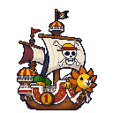
</p>

<h1 align="center">Grand Fleet</h1>

<p align="center">
  <strong>A One Piece crew for every coding adventure.</strong>
  <br>
  Animated ships, familiar faces, and your agents at a glance.
</p>

<p align="center">
  <a href="https://github.com/tiago-peixoto/grand-fleet-herdr/actions/workflows/ci.yml"></a>
  <a href="https://herdr.dev"></a>
  <a href="#compatibility"></a>
</p>

<p align="center">
  <a href="#set-sail">Install</a> ·
  <a href="#meet-the-fleet">Meet the fleet</a> ·
  <a href="#raise-your-flag">Raise your flag</a> ·
  <a href="#read-the-crew">Read the crew</a> ·
  <a href="#compatibility">Compatibility</a> ·
  <a href="#contribute">Contribute</a>
</p>

<p align="center">
  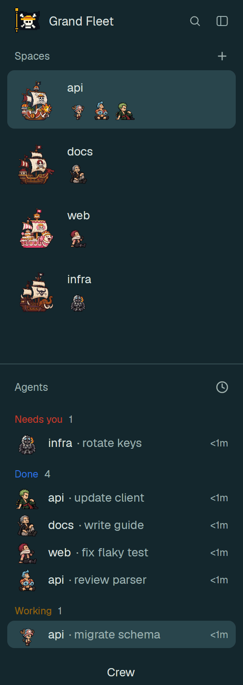
  <br>
  <sub>One continuous 15-second recording of the native sidebar on Linux, at real speed, looping.
  Six scripted stand-in agents report their states.
  The author uses Grand Fleet daily on macOS with <a href="https://github.com/tiago-peixoto/firstmate">a personal Firstmate fork</a>, and it is also tested on Linux.</sub>
</p>

Grand Fleet is a One Piece layout for [Herdr](https://herdr.dev), a desktop app for terminals and coding agents.
Every agent becomes a crewmember, and every Space, Herdr's name for a workspace, with a live agent gets a ship.
[Firstmate](https://github.com/kunchenguid/firstmate), a tool that coordinates coding agents, adds automatically detected captains.
Firstmate is optional: independent agents sail together without a captain.
Ships, crewmembers, and poses need no Firstmate, and captain detection and workers on Firstmate's `hc` backend, which runs them in Herdr terminals, do not need the author's [Firstmate fork](https://github.com/tiago-peixoto/firstmate): upstream Firstmate was checked for those two by reading its code, not by running it.
Secondmates, delegated Firstmate coordinators, on the `hc` backend need the fork until upstream pull request [#8100](https://github.com/kunchenguid/firstmate/pull/8100), [#8340](https://github.com/kunchenguid/firstmate/pull/8340), or [#8586](https://github.com/kunchenguid/firstmate/pull/8586) merges.

- **155 characters, five poses each:** see idle, working, done, blocked, and error states in the crew's artwork.
- **Eight pirate crews:** choose a ship and crew with **Raise a new flag…**.
- **Faces where you work:** character portraits replace program icons in tabs and pane titles, with animated crewmembers in Agents.
- **Native navigation:** ships select workspaces, and characters open agents through Herdr's usual navigation and writable previews.
- **Familiar terminals:** keep native splits, resizing, pinning, sorting, workspace menus, and direct typing into every terminal.

Grand Fleet changes presentation, not delegation or work records.

<p align="center">
  <a href="preview.png">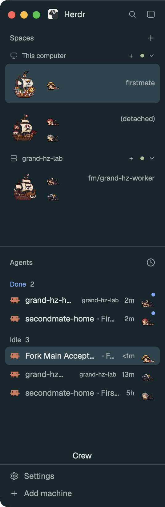</a>
  <br>
  <sub>Native interface captures with stand-in agents and five production poses.
  Click to enlarge.</sub>
  <br>
  <sub>In Herdr, Agents sits below Spaces, and Raise your flag opens as a separate dialog.</sub>
</p>

## Set sail

**Requirements:** an initialized Herdr app configuration and Python 3.9 or newer.
The installer uses Python's standard library.
The [tested versions and limitations](#compatibility) appear below.

> [!IMPORTANT]
> Grand Fleet is experimental.
> Try a separate Herdr test configuration before using your daily setup.
> Read [what the mod accesses](#what-the-mod-accesses) before installation.

### Ask your agent

Copy this request into your coding agent:

> Read the test configuration's AGENTS.md, then add this layout: https://github.com/tiago-peixoto/grand-fleet-herdr/tree/main
> Use an initialized, separate Herdr test configuration.

The [recipe](RECIPE.md#built-from) gives your agent the Layout copy steps, permissions, compatibility check, and verification requirements.
The bundled package targets official Herdr App 0.1.17 and Core 0.1.22 on Linux x86_64.
The destination-aware installer below also supports compatible variations.

### Install manually

Clone the repository:

```sh
git clone https://github.com/tiago-peixoto/grand-fleet-herdr.git
cd grand-fleet-herdr
```

An **app home** is Herdr's configuration directory.
Initialize a separate app home with Herdr, then close that Herdr window.
Replace the example path below with its absolute path:

```sh
python3 tools/install.py install --app-home /absolute/path/to/test-herdr-home
```

Reopen that Herdr window and select **One Piece** in the layout selector.
The installer creates the layout but does not select it.
The usual app home is `~/.config/herdr-app`.

The repository includes a complete [gallery package](RECIPE.md#built-from), with a layout and six generated native modules.
Copying only the mod does not select or place it.
The installer regenerates those modules from your destination's Herdr files and rejects unsupported structures before changing the installation.
It preserves shipped modules, other layouts, settings, and session records.
See [Installation](docs/INSTALL.md) for custom destinations, ownership conflicts, and recovery.

## Meet the fleet

Choose from eight ships and 155 crew characters: eight captains, 139 distinct named crewmembers, and eight generic Pirate variants.
Every character has idle, working, done, blocked, and error poses.
The animations below are shipped with the mod.

<table>
  <tr>
    <th width="50%">Straw Hat Pirates</th>
    <th width="50%">Red Hair Pirates</th>
  </tr>
  <tr>
    <td align="center" valign="top">
      
      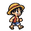
      <p><strong>Thousand Sunny · Luffy</strong></p>
      <p>Chopper, Franky, Zoro, Nami, Usopp, Sanji, Robin, Brook, and Jinbe</p>
    </td>
    <td align="center" valign="top">
      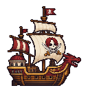
      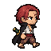
      <p><strong>Red Force · Shanks</strong></p>
      <p>10 named crewmembers, including Benn Beckman, Yasopp, Lucky Roux, Limejuice, and Rockstar</p>
    </td>
  </tr>
  <tr>
    <th>Big Mom Pirates</th>
    <th>Beasts Pirates</th>
  </tr>
  <tr>
    <td align="center" valign="top">
      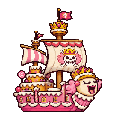
      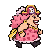
      <p><strong>Queen Mama Chanter · Big Mom</strong></p>
      <p>19 named crewmembers, including Katakuri, Smoothie, Cracker, Perospero, and Pudding</p>
    </td>
    <td align="center" valign="top">
      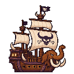
      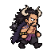
      <p><strong>Mammoth · Kaido</strong></p>
      <p>18 named crewmembers from the Wano era, including King, Queen, Jack, and all six Tobiroppo officers</p>
    </td>
  </tr>
  <tr>
    <th>Heart Pirates</th>
    <th>Whitebeard Pirates</th>
  </tr>
  <tr>
    <td align="center" valign="top">
      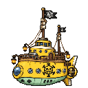
      
      <p><strong>Polar Tang · Law</strong></p>
      <p>8 named crewmembers, including Bepo, Shachi, Penguin, and Jean Bart</p>
    </td>
    <td align="center" valign="top">
      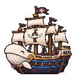
      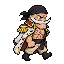
      <p><strong>Moby Dick · Whitebeard</strong></p>
      <p>27 named crewmembers and historical companions, including all 16 division commanders</p>
    </td>
  </tr>
  <tr>
    <th>Roger Pirates</th>
    <th>Kid Pirates</th>
  </tr>
  <tr>
    <td align="center" valign="top">
      
      
      <p><strong>Oro Jackson · Roger</strong></p>
      <p>31 named crewmembers and historical companions, including Rayleigh, Gaban, Crocus, and Oden</p>
    </td>
    <td align="center" valign="top">
      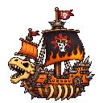
      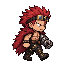
      <p><strong>Victoria Punk · Kid</strong></p>
      <p>21 named crewmembers, including Killer, Heat, Wire, Gig, and Dive</p>
    </td>
  </tr>
</table>

The [complete crew catalog](docs/CREW-CATALOG.md) lists every included member and the historical appearances.
Whitebeard and Roger share four historical characters, so their rosters overlap.

The primary Firstmate defaults to the Straw Hats.
Secondmates, delegated Firstmate coordinators, receive unused secondary crews before crews repeat.
Secondmates on the `hc` backend need the author's [Firstmate fork](https://github.com/tiago-peixoto/firstmate) until upstream Firstmate supports them.
Manual crew selections take priority.
A Space containing only one detected captain's workers shares that captain's flag, matched through Firstmate's existing `firstmate.home` terminal label.
This changes artwork without moving terminals or assigning work.
Extra agents receive numbered generic Pirates when the named roster runs out.

## Raise your flag

Every ship flies the colors you choose.
Right-click a Space with a ship and select **Raise a new flag…**.

<p align="center">
  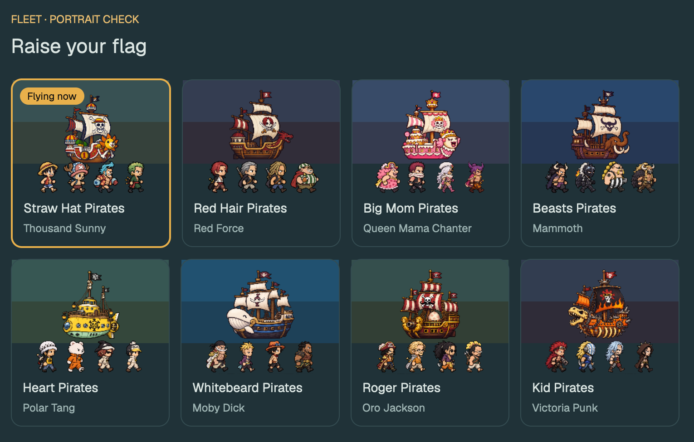
</p>

Each card previews a ship, its captain, and three crewmembers.
**Flying now** marks your current crew.
Choose a card with the pointer or the arrow keys, then press **Set sail** or Enter.
Press Esc to stay with your current crew.

**Set sail** applies the crew and announces the change.
For a Space following a detected captain, this changes the captain's crew too.

An independent fleet receives the least-used eligible crew automatically.
While a captain is active, an independent fleet's flag picker marks the Straw Hats **Reserved for the captain**.
Right-clicking a captain's character in Agents also offers **Raise a new flag…** for that captain's crew.

## Read the crew

<p align="center">
  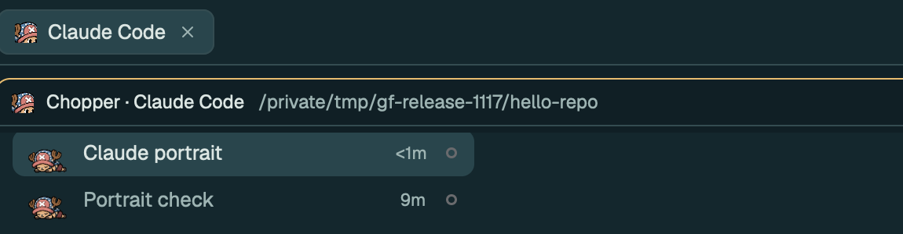
  <br>
  <sub>Portrait placement in an earlier capture.
  The right-side row status marks are no longer shown.</sub>
</p>

<p align="center">
  
  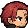
  
  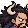
  
  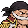
  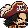
  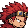
  <br>
  <sub>Every named crewmember has a portrait, cut from its own standing sprite.</sub>
</p>

Character poses follow Herdr's actual agent status.
Session labels remain visible, so you can identify agents even when characters repeat.

| Idle | Working | Done | Needs you | Error |
| :---: | :---: | :---: | :---: | :---: |
| 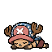 | 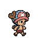 | 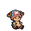 |  | 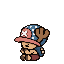 |
| Idle agents sleep | Working agents walk | Finished agents rest with their chin up | Blocked agents fold their arms | Agents with an error hold their face |

**Done** means the agent finished while you were not looking.
It keeps its done pose until you view its terminal, then shows idle.
A finished sub-agent without a terminal pane keeps its done pose.
Crewmember rows have no separate right-side status marks: the pose shows the state, and its tooltip names it.
Unavailable machines retain Herdr's connection handling without invented live activity.

To stop animation throughout the mod, right-click a character and select **Pause animation**.
Use **Resume animation** in the same menu to restore motion.
Choose **Crew lookup…** from a ship's menu, a character's menu, or a miniature's menu.
The **Crew** button also offers the selected fleet's lookup and each agent's appearance menu.
The centered dialog has fleet tabs above character tabs.
Idle, Working, Done, Blocked, and Error each have a 128-pixel preview and a 28-pixel sidebar preview.
Choose **1** through **4** to hold a frame across all five states, or **Play loops** to restore animation.
The lookup initially follows your animation preference without changing it.

A ship opens its catalog for browsing.
A mate opens on its current character.
Choose a named crewmate and review the resulting assignment before applying it.
If another active mate in that roster holds the character, **Confirm named swap** shows both names and both resulting assignments.
One confirmation applies both assignments together.
A returning or unavailable mate keeps its reserved character until the ordinary assignment cleanup releases it.
Switching fleet tabs browses that fleet without moving your mate.
Use **Inspect** to choose for a holder in that fleet instead.
Captain artwork stays reserved for Firstmate, including agents explicitly marked as running Firstmate.
Use **Raise a new flag…** to change a captain's artwork.

Left, Right, Home, and End select tabs within the focused tab bar.
**Escape** or **Close** discards an unconfirmed choice.
These controls change appearance only, never terminal status or workspace membership.
Apply rechecks both identities, their current roster, and the expected exchange.
If the exchange changed, review the revised result before confirming again.

## What the mod accesses

Captain discovery reads existing Firstmate session evidence without requiring mod-specific Firstmate patches, hooks, or registration commands.
Discovery runs every ten seconds and when terminal identities change.
`hc` is the command-line tool for Herdr Core, which runs terminal sessions.

| Access | Purpose |
| --- | --- |
| Herdr agents, terminals, machines, and Spaces | Display the live fleet and retain native navigation |
| `hc get`, the terminal inspection command | Check the terminal's foreground process |
| `state/.lock`, `bin/fm-session-start.sh`, and `.fm-secondmate-home` in that process's folder | Verify Firstmate identity and distinguish primary captains from secondmates |
| Herdr's existing remote machine connection | Read the same evidence on a remote machine |
| Herdr's persisted mod settings | Save captain designations, crew choices for captains and Spaces, character assignments, and animation preferences |

The mod bundles its artwork and makes no external web requests.
It reads discovery files without executing them.
It does not issue task commands or change Firstmate's work records.
Native terminal controls retain Herdr's normal behavior, including ending processes when you close terminals.

If discovery misses Firstmate, open **Crew** and choose its agent.
Select **This agent runs Firstmate**, available when the Space has no captain.
Manual designation applies only to that terminal's identity.
See the [recipe](RECIPE.md#built-from) for the complete integration details.

## Compatibility

The gallery snapshot targets **Herdr App 0.1.17 and Core 0.1.22 on Linux x86_64**.
The [installation guide](docs/INSTALL.md#supported-snapshot) records official archive and executable hashes.
The [gallery verification record](docs/GALLERY.md) distinguishes packaging checks from full fleet acceptance.

The historical acceptance checks used the following setup on **2026-11-16**.
These are tested versions, not a promise of support for every newer release.

| Component | Recorded setup |
| --- | --- |
| Herdr app | 0.1.16 on macOS, using an isolated app identity |
| Herdr Core, the component that runs terminal sessions | Official macOS ARM64 0.1.21 locally and Linux x86_64 0.1.20 remotely |
| Firstmate | [Tested fork revision `653744e`](https://github.com/tiago-peixoto/firstmate/commit/653744ef90aad29eb4c65e3cbba59827b2d1690e), followed by recorded updates to `00311fe` |
| Destination layout | Compatible Spaces, Agents, Menu, Tabs, Pane, and Workspace Chrome modules, with one Spaces slot and one Agents slot under the same parent |

Complete Firstmate fleets need compatible `hc` support, as recorded in the [Firstmate acceptance record](docs/THIN-MOD.md#fork-main-acceptance-2026-11-16).
Recorded checks cover local and remote navigation, direct worker input, crew choices, reopening, and reconnection in isolated sessions.
Later [acceptance records](docs/ACCEPTANCE.md) cover generic fleets and machine islands.
These historical checks do not establish full acceptance of the current release.
The [release verification record](docs/ACCEPTANCE.md#current-release-verification-2026-11-17) documents native text loss after pane zoom and an untested multiple-viewer recovery regression.
See [Core build details](docs/INSTALL.md#core-build-used-for-current-recovery-verification) for recovery limitations.

### Update or remove

For an installer-managed copy, close the destination window after updating this checkout or Herdr.
Rerun the install command with the same app home.
This refreshes the copied native modules and generated layout.
If compatibility checks fail, retain the existing installation and follow the [recovery guide](docs/INSTALL.md#failures-and-recovery).

To remove Grand Fleet, select another layout and close the destination window first:

```sh
python3 tools/install.py uninstall --app-home /absolute/path/to/test-herdr-home
```

Removal deletes only unchanged installer-owned files and its receipt.
Modified owned files block removal, while added files remain.
Legacy installations also have [specific shortcut cleanup rules](docs/INSTALL.md#legacy-shortcut-cleanup).
A gallery copy has no installer receipt.
Follow the [gallery refresh and removal steps](docs/INSTALL.md#gallery-refresh-and-removal) instead of overwriting it or invoking installer removal.

## Contribute

Start with [VISION.md](VISION.md), the project's acceptance policy, then [AGENTS.md](AGENTS.md) and the [thin presentation design](docs/THIN-MOD.md).
[Open an issue](https://github.com/tiago-peixoto/grand-fleet-herdr/issues/new) with your Herdr version, reproduction steps, and a screenshot when appearance matters.
Remove private terminal content before sharing screenshots or logs.

Use Node.js 22, Python 3.13, and ImageMagick, the image processing tools, to match the automated workflow.
Run from the repository:

```sh
npm test
python3 -B -m unittest discover -s tests -v
git diff --check
```

For native changes, install into an isolated app home and check that same destination:

```sh
herdr-app check /absolute/path/to/test-herdr-home/mods/one-piece
node tools/check-parity.mjs /absolute/path/to/test-herdr-home
```

The first command checks initial rendering.
The second compares simulated native behavior.
Neither proves live session preservation, remote recovery, or visual accuracy.
Complete native interaction checks in the isolated Grand Fleet Lab as described in [AGENTS.md](AGENTS.md#verification).

## Ship's log

| Guide | What you will find |
| --- | --- |
| [Installation](docs/INSTALL.md) | Setup, refresh, ownership, removal, and recovery |
| [Acceptance review](docs/ACCEPTANCE.md) | Verified scenarios and remaining release limits |
| [Native verification](docs/NATIVE-INTEGRATION.md) | Detailed current and historical interaction checks |
| [Crew catalog](docs/CREW-CATALOG.md) | Named rosters, historical companions, and canonical sources |
| [Artwork inventory](docs/ARTWORK.md) | Original artwork sources and historical references |

The [browser prototype](prototype/index.html) preserves an earlier design with simulated terminals and replies.
Its behavior is historical and is superseded by the current vision.
See the [prototype guide](docs/PROTOTYPE.md) for its editable sources and rebuild script.

## Credits

Built on [Herdr](https://herdr.dev) and [Firstmate](https://github.com/kunchenguid/firstmate), with custom One Piece pixel artwork.
The installed artwork lives in [mods/one-piece/assets](mods/one-piece/assets/).
Original Grand Fleet code uses the [MIT License](LICENSE).
The bundled Herdr modules and derived layout retain Herdr's [Apache-2.0 license](mods/one-piece/HERDR-LICENSE).
Neither code license grants rights to the artwork or One Piece characters.

One Piece was created by Eiichiro Oda.
Grand Fleet is an unofficial fan project, unaffiliated with One Piece's rights holders.
This repository does not grant rights to One Piece characters.

<p align="center"></p>
