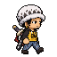
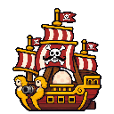
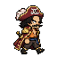
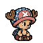
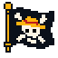

<p align="center">
  
</p>

<h1 align="center">Grand Fleet</h1>

<p align="center">
  <strong>A One Piece crew for every coding adventure.</strong>
  <br>
  Animated ships, familiar faces, and your agents at a glance.
</p>

<p align="center">
  <a href="https://github.com/tiago-peixoto/herdr-one-piece/actions/workflows/ci.yml"></a>
  <a href="https://herdr.dev"></a>
  <a href="#compatibility"></a>
</p>

<p align="center">
  <a href="#set-sail">Install</a> ·
  <a href="#meet-the-fleet">Meet the fleet</a> ·
  <a href="#read-the-crew">Read the crew</a> ·
  <a href="#compatibility">Compatibility</a> ·
  <a href="#contribute">Contribute</a>
</p>

Grand Fleet is a One Piece mod for [Herdr](https://herdr.dev), a desktop app for terminals and coding agents.
Every agent becomes a crewmember in Herdr's sidebar.
[Firstmate](https://github.com/kunchenguid/firstmate), a tool that coordinates coding agents, adds automatically detected captains and ships for their workspaces.
Ordinary agents get character artwork without Firstmate.

- **Ships for your Spaces:** Herdr's workspaces display a ship when a Firstmate captain is aboard.
- **Characters for your agents:** familiar faces keep their assignments beside actual session labels as other agents arrive or leave.
- **One click to your work:** ships select existing workspaces, while characters use native agent navigation and writable terminal previews.
- **Your terminals stay familiar:** keep native tabs, splits, resizing, pinning, sorting, workspace menus, and direct typing into worker and personal terminals.
- **A calm sidebar:** Spaces and Agents each retain one scrolling list, with native machine identities and optional animation.

Firstmate owns delegation and work records.
Grand Fleet supplies the artwork and sidebar presentation.

<details>
<summary><strong>See Grand Fleet in Herdr</strong> · Native sidebar screenshot</summary>

<p align="center">
  <a href="preview.png"></a>
  <br>
  <sub>Click the screenshot to view it at full size.</sub>
</p>

</details>

## Set sail

**Requirements:** an initialized Herdr app configuration and Python 3.9 or newer.
The installer uses Python's standard library.
The [tested versions and limitations](#compatibility) appear below.

> [!IMPORTANT]
> Grand Fleet is experimental.
> Try a separate Herdr test configuration before using your daily setup.
> Read [what the mod accesses](#what-the-mod-accesses) before installation.

### Ask your agent

Copy this request into your coding agent:

> Read https://github.com/tiago-peixoto/herdr-one-piece/blob/main/RECIPE.md and install Grand Fleet into an initialized, separate Herdr test configuration.

The [recipe](RECIPE.md) gives your agent the installation steps, permissions, and verification requirements.

### Install manually

Clone the repository:

```sh
git clone https://github.com/tiago-peixoto/herdr-one-piece.git
cd herdr-one-piece
```

An **app home** is Herdr's configuration directory.
Initialize a separate app home with Herdr, then close that Herdr window.
Replace the example path below with its absolute path:

```sh
python3 tools/install.py install --app-home /absolute/path/to/test-herdr-home
```

Reopen that Herdr window and select **One Piece** in the layout selector.
The installer creates the layout but does not select it.
The usual app home is `~/.config/herdr-app`.

**Use the installer:** copying `mods/one-piece/` alone leaves required native modules missing.
The installer derives them from your destination's Herdr files and rejects unsupported structures before changing the installation.
It preserves shipped modules, other layouts, settings, and session records.
See [Installation](docs/INSTALL.md) for custom destinations, ownership conflicts, and recovery.

## Meet the fleet

Eight ships, eight captains, and 139 distinct named crewmembers accompany your agents.
These animations use the same artwork shipped with the mod.

<table>
  <tr>
    <th width="50%">Straw Hat Pirates</th>
    <th width="50%">Red Hair Pirates</th>
  </tr>
  <tr>
    <td align="center" valign="top">
      
      
      <p><strong>Thousand Sunny · Luffy</strong></p>
      <p>Chopper, Franky, Zoro, Nami, Usopp, Sanji, Robin, Brook, and Jinbe</p>
    </td>
    <td align="center" valign="top">
      
      
      <p><strong>Red Force · Shanks</strong></p>
      <p>10 named crewmembers, including Benn Beckman, Yasopp, Lucky Roux, Limejuice, and Rockstar</p>
    </td>
  </tr>
  <tr>
    <th>Big Mom Pirates</th>
    <th>Beasts Pirates</th>
  </tr>
  <tr>
    <td align="center" valign="top">
      
      
      <p><strong>Queen Mama Chanter · Big Mom</strong></p>
      <p>19 named crewmembers, including Katakuri, Smoothie, Cracker, Perospero, and Pudding</p>
    </td>
    <td align="center" valign="top">
      
      
      <p><strong>Mammoth · Kaido</strong></p>
      <p>18 named crewmembers from the Wano era, including King, Queen, Jack, and all six Tobiroppo officers</p>
    </td>
  </tr>
  <tr>
    <th>Heart Pirates</th>
    <th>Whitebeard Pirates</th>
  </tr>
  <tr>
    <td align="center" valign="top">
      
      
      <p><strong>Polar Tang · Law</strong></p>
      <p>8 named crewmembers, including Bepo, Shachi, Penguin, and Jean Bart</p>
    </td>
    <td align="center" valign="top">
      
      
      <p><strong>Moby Dick · Whitebeard</strong></p>
      <p>27 named crewmembers and historical companions, including all 16 division commanders</p>
    </td>
  </tr>
  <tr>
    <th>Roger Pirates</th>
    <th>Kid Pirates</th>
  </tr>
  <tr>
    <td align="center" valign="top">
      
      
      <p><strong>Oro Jackson · Roger</strong></p>
      <p>31 named crewmembers and historical companions, including Rayleigh, Gaban, Crocus, and Oden</p>
    </td>
    <td align="center" valign="top">
      
      
      <p><strong>Victoria Punk · Kid</strong></p>
      <p>21 named crewmembers, including Killer, Heat, Wire, Gig, and Dive</p>
    </td>
  </tr>
</table>

The [complete crew catalog](docs/CREW-CATALOG.md) lists every included member and the historical appearances.
Whitebeard and Roger share four historical characters, so their rosters overlap.

The primary Firstmate defaults to the Straw Hats.
Secondmates, delegated Firstmate coordinators, receive unused secondary crews before crews repeat.
Your manual crew selections take priority over automatic discovery.
Extra agents receive numbered generic Pirates after a crew's named artwork runs out.
Your fleet can grow beyond the named roster.

**Choose your colors:** right-click a captain's Space and select **Choose ship and crew**.
The choice updates its ship, captain, and crewmembers in that Space together.
The crew strip reflects existing Space membership without moving terminals or assigning work.

## Read the crew

Character poses follow Herdr's actual agent status.
Session labels remain visible, so you can identify agents even when characters repeat.

| Resting | Working | Needs you |
| :---: | :---: | :---: |
|  |  |  |
| Idle agents sleep | Working agents walk | Blocked agents sit beside Herdr's attention indication |

**Done** agents rest beside Herdr's completion label or compact completion dot.
A resting pose alone does not mean work is complete.
Unavailable machines retain Herdr's connection handling without invented live activity.

To stop animation, right-click a character and select **Pause animation**.
Use **Resume animation** in the same menu to restore motion.
These controls change appearance only.

## What the mod accesses

Captain discovery reads existing Firstmate session evidence without requiring mod-specific Firstmate patches, hooks, or registration commands.
Discovery runs every ten seconds and when terminal identities change.
`hc` is the command-line tool for Herdr Core, which runs terminal sessions.

| Access | Purpose |
| --- | --- |
| Herdr agents, terminals, machines, and Spaces | Display the live fleet and retain native navigation |
| `hc get`, the terminal inspection command | Check the terminal's foreground process |
| `state/.lock`, `bin/fm-session-start.sh`, and `.fm-secondmate-home` in that process's folder | Verify Firstmate identity and distinguish primary captains from secondmates |
| Herdr's existing remote machine connection | Read the same evidence on a remote machine |
| Herdr's persisted mod settings | Save captain designations, crew choices, character assignments, and animation preferences |

The mod bundles its artwork and makes no external web requests.
It reads discovery files without executing them.
It does not issue task commands or change Firstmate's work records.
Native terminal controls retain Herdr's normal behavior, including ending processes when you close terminals.

If discovery cannot read a captain's evidence, open **Crew**, choose the agent, and select **This agent runs Firstmate**.
Manual designation applies to that terminal's identity and never transfers to a replacement session.
See the [recipe](RECIPE.md#built-from) for the complete integration details.

## Compatibility

The recorded acceptance checks used the following setup on **2026-11-16**.
These are tested versions, not a promise of support for every newer release.

| Component | Recorded setup |
| --- | --- |
| Herdr app | 0.1.16 on macOS, using an isolated app identity |
| Herdr Core, the component that runs terminal sessions | Official macOS ARM64 0.1.21 locally and Linux x86_64 0.1.20 remotely |
| Firstmate | [Tested fork revision `653744e`](https://github.com/tiago-peixoto/firstmate/commit/653744ef90aad29eb4c65e3cbba59827b2d1690e), followed by recorded updates to `00311fe` |
| Destination layout | Compatible Spaces, Agents, and Menu modules, with one Spaces slot and one Agents slot under the same parent |

Generic agent artwork works without Firstmate.
Complete Firstmate fleets need compatible support for `hc`, the Herdr Core command-line tool.
The [Firstmate acceptance record](docs/THIN-MOD.md#fork-main-acceptance-2026-11-16) identifies the tested integration.

Recorded checks cover local and remote navigation, direct worker input, crew choices, app reopening, and remote reconnection in isolated sessions.
The [acceptance review](docs/ACCEPTANCE.md#release-limitations) records remaining limits, including the isolated app identity and remote files not reread after final restarts.
See [Core build details](docs/INSTALL.md#core-build-used-for-current-recovery-verification) for the tested executables and recovery limitations.

### Update or remove

After updating this checkout or Herdr, close the destination window and rerun the install command with the same app home.
This refreshes the copied native modules and generated layout.
If compatibility checks fail, retain the existing installation and follow the [recovery guide](docs/INSTALL.md#failures-and-recovery).

To remove Grand Fleet, select another layout and close the destination window first:

```sh
python3 tools/install.py uninstall --app-home /absolute/path/to/test-herdr-home
```

Removal deletes only unchanged installer-owned files and its receipt.
Modified owned files block removal, while added files remain.
Legacy installations also have [specific shortcut cleanup rules](docs/INSTALL.md#legacy-shortcut-cleanup).

## Contribute

Start with [VISION.md](VISION.md), the project's acceptance policy, then [AGENTS.md](AGENTS.md) and the [thin presentation design](docs/THIN-MOD.md).
[Open an issue](https://github.com/tiago-peixoto/herdr-one-piece/issues/new) with your Herdr version, reproduction steps, and a screenshot when appearance matters.
Remove private terminal content before sharing screenshots or logs.

Use Node.js 22, Python 3.13, and ImageMagick, the image processing tools, to match the automated workflow.
Run from the repository:

```sh
npm test
python3 -B -m unittest discover -s tests -v
git diff --check
```

For native changes, install into an isolated app home and check that same destination:

```sh
herdr-app check /absolute/path/to/test-herdr-home/mods/one-piece
node tools/check-parity.mjs /absolute/path/to/test-herdr-home
```

The first command checks initial rendering.
The second compares simulated native behavior.
Neither proves live session preservation, remote recovery, or visual accuracy.
Complete native interaction checks in the isolated Grand Fleet Lab as described in [AGENTS.md](AGENTS.md#verification).

## Ship's log

| Guide | What you will find |
| --- | --- |
| [Installation](docs/INSTALL.md) | Setup, refresh, ownership, removal, and recovery |
| [Agent recipe](RECIPE.md) | Interface, permissions, and installation acceptance checks |
| [Vision](VISION.md) | Approved behavior and Firstmate's governing role |
| [Thin presentation design](docs/THIN-MOD.md) | Current sidebar contract and integration evidence |
| [Acceptance review](docs/ACCEPTANCE.md) | Verified scenarios and remaining release limits |
| [Native verification](docs/NATIVE-INTEGRATION.md) | Detailed current and historical interaction checks |
| [Crew catalog](docs/CREW-CATALOG.md) | Complete named rosters, historical companions, and canonical sources |
| [Artwork inventory](docs/ARTWORK.md) | Original artwork sources and historical references |

The [browser prototype](prototype/index.html) preserves an earlier design with simulated terminals and replies.
Its behavior is historical and is superseded by the current vision.
See the [prototype guide](docs/PROTOTYPE.md) for its editable sources and rebuild script.
Review boards and author verdict transcripts stay outside this repository.

## Credits

Built on [Herdr](https://herdr.dev) and [Firstmate](https://github.com/kunchenguid/firstmate), with custom One Piece pixel artwork.
The installed artwork lives in [mods/one-piece/assets](mods/one-piece/assets/).
Archived third-party reference artwork is not installed.

One Piece was created by Eiichiro Oda.
Grand Fleet is an unofficial fan project, unaffiliated with One Piece's rights holders.
This repository does not grant rights to One Piece characters or archived third-party artwork.

<p align="center"></p>
