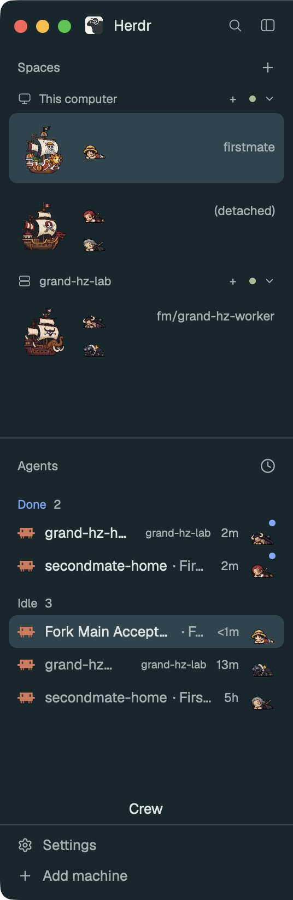

# Grand Fleet

Turn Herdr's Spaces and Agents sidebar into a One Piece fleet with animated ships and crewmembers.
Every agent has a character, and running Firstmate instances become captains automatically.
Keep ordinary terminals, machine grouping, and native navigation.



## What you see

Spaces occupy the upper sidebar region, grouped by actual machine name.
Agents occupy the lower region with Herdr's status groups and session labels.
Each region scrolls independently.
A captain's expanded Space row is 64 pixels high with a 6-pixel gap below it.
Its 48-pixel ship sits beside a 24-pixel captain portrait, with 24-pixel crewmates underneath.
A Space with agents but no captain uses the same row with its Space name in place of the captain portrait.
Compact fleet rows show a 32-pixel ship in a 36-pixel row.
The Crew button opens appearance controls below Agents.
Settings and Add machine remain native controls.
The generated layout supplies dark teal backgrounds and gold accents while preserving explicit user colors.
Defaults include background `#101f25`, selected `#29454c`, foreground `#dce6e3`, and accent `#e8bd70`.

## How it behaves

Working characters walk, idle characters sleep, and blocked characters sit beside the native attention indication.
Done characters use the resting pose with Herdr's Done label or compact completion dot.
Other statuses retain native labels and a resting pose.
Ships animate without changing session state.
Pause animation selects static PNG frames instead of GIF animation.
Clicking a ship selects its existing Space.
Clicking a portrait focuses that agent's existing terminal.
Right-click any Space with a ship to choose a ship and crew directly below Rename.
Right-click a character or use Crew for appearance controls and manual captain designation.
A primary Firstmate defaults to Straw Hats.
Secondmates receive unused secondary crews before crews repeat.
A Space without a captain receives the least-used crew, and Straw Hats only while no captain is live.
When several captains share a Space, the primary and then the oldest terminal supply its ship.
Manual choices survive discovery and do not transfer to replacement terminal identities.
Extra workers receive numbered generic Pirates after named artwork is exhausted.
Unavailable machines retain Herdr's connection behavior without fabricated live activity.
Worker terminals accept direct typing, and personal terminals retain native controls.
No shortcut bindings are required.

## Built from

The source folder is `mods/one-piece/` with `mod.json` declaring `place: none`.
There is no distributable `layouts/` folder because the installer derives the layout from the destination Herdr installation.
The module uses the `region: spaces` and `region: agents` properties in the two native sidebar slots.
`tools/install.py` and `tools/compat.py` generate copies of the destination's Spaces, Agents, and Menu modules.
The mod subclasses those copies instead of replacing Herdr's terminal system.
The installer generates a separate `layouts/one-piece.json` and records ownership for refresh and removal.
It never selects the layout, changes shipped modules, or starts terminal sessions.
It preserves ordinary settings and shortcuts.

The native module reads `agents`, `terminals`, `machines`, `spaces`, `layout`, and `theme` from Herdr.
It stores appearance and captain choices through `shared` and `setShared`.
It uses `openOverlay` and `closeOverlay` for native menus.
Navigation uses native `agent.focus`, `space.select`, and `space.move` commands.
The retired view fallback can use native `terminal.peek`.
Inherited Spaces and Agents controls retain their shipped behavior.
Artwork consists of the custom pixel PNG and GIF files in `mods/one-piece/assets/`.

Before installation, tell the user that automatic captain discovery calls Herdr's `hc get` interface and reads files outside the mod folder.
It reads the foreground process folder's `state/.lock`, `bin/fm-session-start.sh`, and `.fm-secondmate-home` on the corresponding machine.
Remote reads use Herdr's existing machine connection.
The mod does not download artwork, call external web services, or execute task commands.
Discovery checks every ten seconds and when terminal identities change.
Its reads verify process and terminal identity before accepting a captain.
A manual designation is available when this evidence cannot be read.

## Install

Read the destination's `~/.config/herdr-app/AGENTS.md` and inspect this repository before installing.
Close only the destination Herdr application before replacing installation files.
Use Python 3.9 or newer and run from the downloaded repository:

```sh
python3 tools/install.py install --app-home ~/.config/herdr-app
```

Open Herdr and select One Piece in the layout selector.
For a custom app home, substitute its absolute path explicitly.
The compatibility check must pass before any destination files change.
Keep `tools/install.py` and `tools/compat.py` together for later refresh or removal.
See [Installation](docs/INSTALL.md) for ownership conflicts, removal, and recovery.
Use the same installer after a Herdr update to refresh the copied native modules.

## Watch out

Copying only `mods/one-piece/` is insufficient because the native base modules are generated during installation.
Do not invent replacements for missing native dependencies or overwrite an existing unknown One Piece installation.
The destination needs compatible Agents, Spaces, and Menu sources and exactly one Spaces and one Agents slot under the same parent.
The mod never moves workers between Spaces or changes process ownership.
It identifies captains from existing Firstmate evidence, not names or folders alone.
Generic agents work without Firstmate.
Complete Firstmate fleets need the generic hc support available in the tested fork revision documented in [Acceptance](docs/ACCEPTANCE.md).
This is not a promise that every Firstmate revision supports hc fleets.
The verified setup used Herdr 0.1.16, local Core 0.1.21, and remote Linux Core 0.1.20.
Physical testing used an isolated app identity with equivalent executable code and resources.
The historical prototype and third-party reference assets are not installed by the mod.
This is an unofficial fan project and does not grant rights to One Piece characters.

## Done when

- The installer rejects unsupported source or layout structures before changing the destination.
- The installed mod passes `herdr-app check` and the repository's native parity check.
- Spaces and Agents scroll independently and show agents on their actual machines.
- Clicking a ship selects its Space, while clicking a portrait reaches that character's existing writable terminal.
- A real Firstmate is detected without manual registration, and secondary captains receive distinct default crews.
- User crew choices survive discovery and app reopening.
- Sleeping, walking, sitting, and Done presentations match the actual native statuses.
- App reopening and remote transport reconnection preserve running terminal identities and accept fresh typed input.
- Ordinary personal terminals, native menus, Settings, and Add machine remain available.
